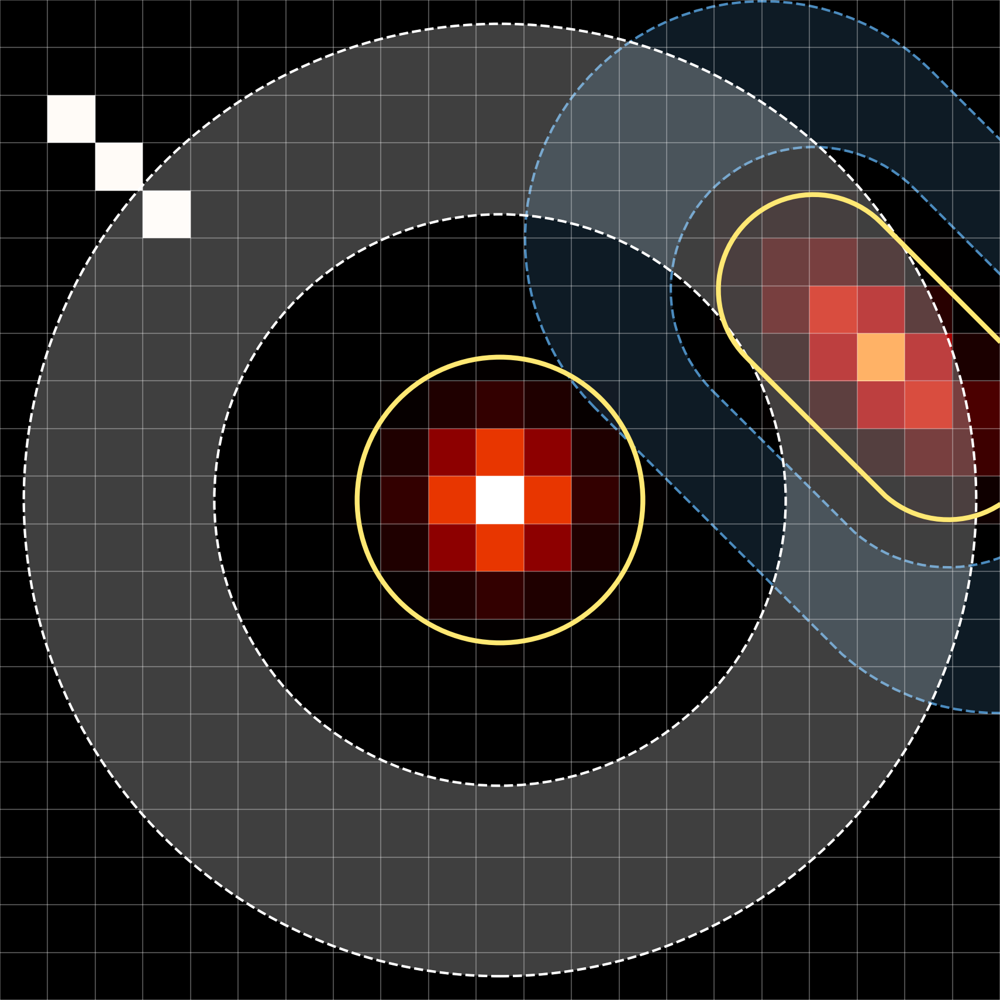

# astroapers

(Astronomy + Apertures + Rust(rs) = astroapers)

<p align="center">
  <br>
</p>


`astroapers` is a Rust-backed Python package for exact pixel-aperture overlap,
bbox-tight aperture weights, and aperture summation in pixel coordinates.
Although it was developed for astronomical image analysis, the core algorithms
operate on generic two-dimensional image arrays. They can also be useful for
other scientific and technical images, including microscopy, photography, and
any workflow that needs reproducible measurements over pixel-defined apertures
or regions.

The package exposes three public layers:

- `PixelAp` objects such as `CircAp`, `EllipAp`, `RectAp`, `PillAp`, `WedgeAp`, and `*An` for readable workflows, plotting, weights, and one-shot aperture
  sums.
- `bboxes()`, `weights_exact()`, and `BoundingBox` methods for reusing bbox-tight
  aperture weights.
- `import astroapers._rust as aapr` for expert users who need the raw extension functions within python and
  are willing to supply C-contiguous arrays and handle raw return values. (For how-tos for `aapr`, inspect `astroapers.kernels`; it is the Python layer that calls `_rust` internally).

Project links:

- Documentation: <https://ysbach.github.io/astroapers/>
- Rust API reference: <https://docs.rs/astroapers>
- GitHub: <https://github.com/ysbach/astroapers>

## Install

`astroapers` builds a native Rust extension with `maturin`, so source installs
require a working Rust/Cargo toolchain.


```bash
# You may activate your Python environment before this, e.g.,
# source ~/.venvs/your_env/bin/activate

# General install:
uv pip install -e .

# development install:
uv pip install -e ".[dev]"
```

Then try tests:
```bash
uv run pytest -q
```

For Rust crate use:

```toml
[dependencies]
astroapers = "<version>"
```

Replace `<version>` with the release version you want to depend on.

## Quickstart

```python
import astroapers as aap

ap = aap.CircAp((42.3, 17.2), r=3.0)
apsum, npix = ap.apsum_exact(data, mask=bad_pixels)  # return_npix=True by default
weights = ap.weights_exact()[0]
center_weights = ap.weights_center()[0]
bbox = ap.bboxes()[0]
center_samples = ap.sampled_values(data)[0]
weighted_values = ap.weighted_values(data)[0]
fits_section = bbox.to_fits_section(data.shape)

wedge = aap.WedgeAp((42.3, 17.2), r_in=5.0, r_out=50.0, theta_in=0.0, dtheta_in=0.2)
wedge_sum, wedge_npix = wedge.apsum_exact(data)
```

For maximum-performance:

```python
import astroapers._rust as aapr

x = np.ascontiguousarray(x, dtype=np.float64)
y = np.ascontiguousarray(y, dtype=np.float64)
data = np.ascontiguousarray(data, dtype=np.float64)

apsum = aapr.apsum_circ_exact_sum(data, x, y, 3.0)
```

## Dtype caveats

`astroapers` performs geometry and public aperture-sum outputs in `float64`.
The raw `_rust` functions provide only basic validation and do not perform mask
handling, dtype conversion, or return shaping. Use C-contiguous (row-major)
arrays with the dtype-specific raw function (`*_f32`, `*_i32`, `*_i16`) when
not using `float64`. Coordinate inputs
and scalar geometry parameters are expected to be `float64`-compatible.
Raw image, path-data, and mask functions reject arrays that are not C-contiguous.
Use `np.ascontiguousarray()` before raw calls; public Python wrappers handle
the layout conversion automatically.

Bbox-tight weights from `PixelAp.weights_exact()` are `float64`. When user-supplied
weights are passed to `BoundingBox` methods, only `float32` and `float64` arrays
are preserved. Other numeric or boolean weight arrays, including extended
precision dtypes such as `float128`/`longdouble` where NumPy provides them, are
converted to `float64`. `BoundingBox.to_image()`, `weighted_cutout()`, and
`weighted_values()` preserve `float32` when both data and weights are `float32`,
but `BoundingBox.apsum()` and `BoundingBox.npix()` always accumulate in
`float64`. Bad-pixel masks passed as `mask=` are converted to boolean, where
`True` means excluded.

`weights_center()` and `sampled_values(data)` are related but not synonyms:
`weights_center()` returns bbox-tight binary weights, while
`sampled_values(data)` returns the raw image values selected by the positive
center weights.

## Position ownership

Apertures own a read-only `float64` copy of their coordinates. Changing the
input array after construction does not move the aperture, and editing or
reassigning `ap.positions` raises an error. Construct a new aperture to move it:

```python
ap = aap.CircAp((10.0, 20.0), r=3.0)
moved = aap.CircAp((12.0, 20.0), r=ap.r)
```

This also applies to `validate=False`: it skips input checks but still copies
coordinates. The stored `(N, 2)` positions use Fortran order so the Rust kernels
can access contiguous x and y columns without separate coordinate copies.
Scalar input `(x, y)` retains scalar results; `[(x, y)]` retains length-one
vector results.

Constructor inputs can be lists, C-order arrays, Fortran-order arrays, or
strided arrays; no layout conversion is needed before construction. Reuse an
aperture across images when its centers and geometry stay the same. Pass all
centers together as an `(N, 2)` array for batched measurements.

For already valid inputs, `validate=False` can make construction roughly twice
as fast, but the absolute cost is already measured in **microseconds**. One
local single-center `CircAp` measurement was **1.66 µs → 0.75 µs** (2.2×);
10,000-center cases showed 1.3–2.0× speedups depending on layout. These are
machine-specific construction timings; total photometry speedups can be smaller.
See [construction and repeated measurements](docs/quarto/performance.qmd#construction-and-repeated-measurements).

## Releases

Branch pushes and pull requests run Rust checks and test installed Python wheels
and source distributions. A manual `release.yml` run rehearses all platform builds
without publishing. Pushing a matching `vX.Y.Z` tag in `ysBach/astroapers` publishes
the validated release to PyPI and crates.io, then creates its GitHub release.
Tag pushes in forks build and test without publishing.

See [RELEASING.md](RELEASING.md) for one-time trusted-publisher setup, the release
checklist, supported wheel targets, and failure recovery.

## Conventions

Coordinates follow the SEP/Photutils pixel convention: pixel `(x, y)` is
centered at integer coordinates and covers `[x - 0.5, x + 0.5]`.
